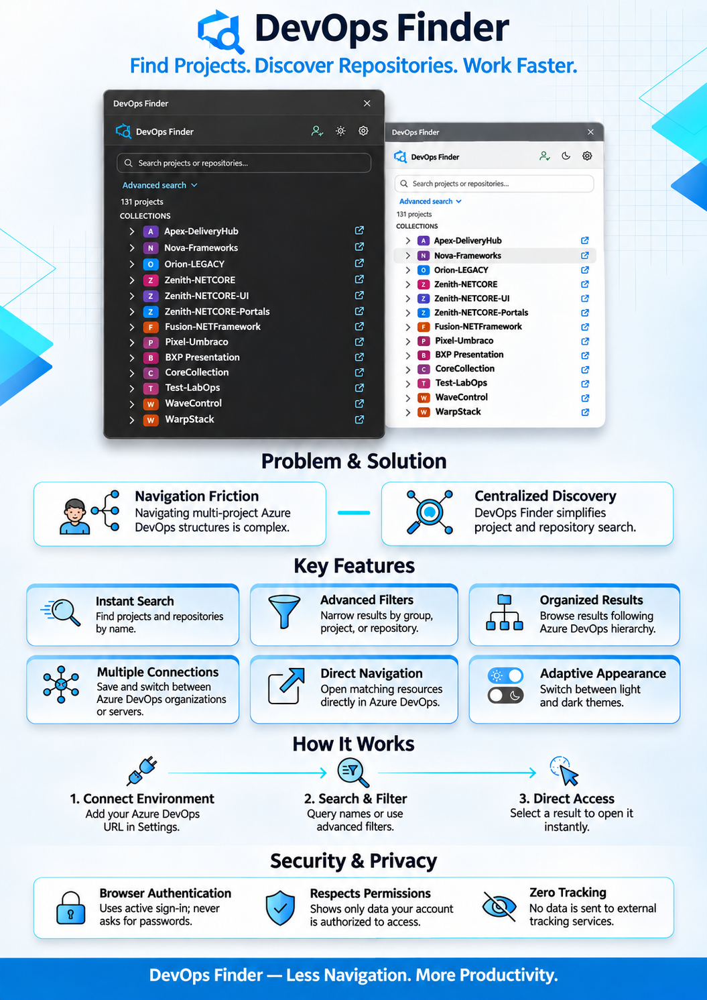

# DevOps Finder

> **Chrome Web Store:** [Replace this placeholder with the published listing](https://chromewebstore.google.com/detail/REPLACE_WITH_EXTENSION_ID)

If your team uses Azure DevOps to organize projects and store code, DevOps Finder helps you quickly find the right project or code repository and open it. A repository is simply a place where a team keeps its code.

## What you can do

- Search for a project or code repository by name.
- Browse projects and repositories grouped the same way as in Azure DevOps.
- Narrow results by group, project, or repository.
- Open a project or repository directly in Azure DevOps.
- Save more than one Azure DevOps connection and switch between them.
- See available results even if some information cannot be loaded.
- Choose a light or dark appearance.

## Using DevOps Finder

1. Sign in to the Azure DevOps site where your team works.
2. Open DevOps Finder from a tab on that site. The first time you use it, open **Settings** and add the web address for your Azure DevOps organization or server.
3. Type a name to search, or use **Advanced search** to narrow the list.
4. Select a result to open it in Azure DevOps.

If the browser asks for permission to access your Azure DevOps site, allow it so the extension can search that site.

An organization address often looks like `https://dev.azure.com/your-organization`. Your team may use a different address.

## Your data and privacy

- DevOps Finder uses the Azure DevOps sign-in already open in your browser. It never asks for your password.
- It only shows information your account is allowed to see.
- Information is requested directly from your Azure DevOps site and kept temporarily while the extension is open.
- Your saved site addresses and appearance choice stay in this browser profile.
- The extension does not send your information to a separate tracking or inventory service.

For full details, see the [Privacy Policy](PRIVACY.md).

## If you cannot find something

Make sure you are signed in to the right Azure DevOps site and that the correct site is selected in **Settings**. If some projects or repositories are still missing, your account may not have access to them, or Azure DevOps may not have provided all the information yet.

## License

The extension's source code does not currently have a stated license. `bowtie-license.txt` applies separately and does not cover the whole project.

The Material Symbols Rounded icon subset from Google Fonts is licensed under Apache 2.0; see [the included license](licenses/material-symbols-LICENSE.txt).
